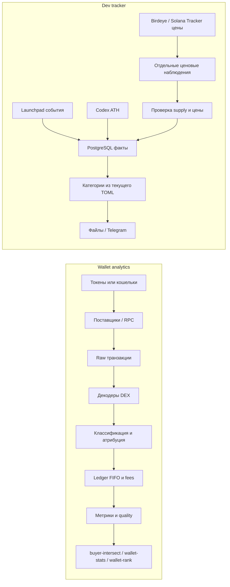

# trader-scout: путеводитель по проекту для C++ разработчика

**Срез кода и данных: 11 октября 2026 года.** Здесь описано, что реально есть в рабочем дереве и отдельном сервисе `dev-tracker`; проектная спецификация не означает, что каждый запланированный слой уже реализован. Подробные заметки о Rust лежат в [`docs/rust/`](rust/00-README.md), история решений — в [`docs/adr/`](adr/).

## Зачем существует проект

`trader-scout` читает публичную историю Solana, BSC, Base и Robinhood Chain и пытается восстановить спотовые DEX-операции кошельков: где была покупка или продажа, какой актив и сколько единиц перешло, кто с достаточной уверенностью контролировал экономическую сторону операции, сколько стоил приобретенный инвентарь и что известно о результате. Приватные ключи не нужны и торговые транзакции программа не подписывает.

У проекта два разных продукта. Пакет CLI исследует кошельки и торговую активность. Отдельный постоянно работающий `dev-tracker` хранит факты о запусках токенов, их миграции с кривых, ATH-наблюдения и строит категории создателей. Второй сервис нужен для списков создателей, не для мониторинга «умных денег».

Три основных CLI делят анализ, но отвечают на разные вопросы:

| Команда | Вопрос | Что сохраняет в результате |
|---|---|---|
| `buyer-intersect` | Какие кошельки подтвердили покупку как минимум K различных входных токенов? | Кандидаты и подтверждения по токенам; K по умолчанию 2. |
| `wallet-stats` | Что известно по каждому входному кошельку в заданном периоде? | Все кошельки, в том числе без активности, с N/A, неполной историей и причинами. |
| `wallet-rank` | Какие кошельки проходят quality gates и как они ранжируются? | Не более `--top N` результатов (обычно 20) плюс исключения и причины. |

Рейтинг не должен скрывать плохие или неполные наблюдения. Нулевая прибыль отличается от неизвестной себестоимости; неизвестная цена не означает нулевую цену. PnL — аналитическая оценка публичной DEX-активности, не налоговый отчет и не обещание будущей доходности. Адрес кошелька также не доказывает личность человека.

В workspace есть инженерные утилиты [`scout-capture`](../bins/scout-capture/src/main.rs) и `evm-capture`: они сохраняют ограниченные, отредактированные provider captures для диагностики и golden fixtures. Это не еще два аналитических CLI и не полный архив цепи.

## Как устроен репозиторий

Это Cargo workspace: несколько библиотек и исполняемых программ собираются из одного дерева и используют общий `Cargo.lock`. Корневой [`Cargo.toml`](../Cargo.toml) объявляет workspace, общие версии зависимостей, Rust edition 2024 и lint-политику. `bins/` содержит точки входа команд; `crates/` — библиотеки, которые можно собирать и использовать отдельно.

Текущая карта ответственности:

| Слой | Crates | Ответственность |
|---|---|---|
| Типы предметной области | `scout-core` | Идентичность chain/wallet/asset, суммы, ошибки, доверие к данным. |
| Источники и интерфейсы | `scout-api`, `scout-scan`, `scout-rpc`, `scout-providers` | Контракты источников, пагинация, RPC/HTTP, ограничения и ответы поставщиков. |
| Форматы цепей и DEX | `scout-evm`, `scout-solana`, `scout-dex-evm`, `scout-dex-solana` | Представления транзакций и протокольные декодеры. |
| Экономический смысл | `scout-normalize`, `scout-pricing`, `scout-ledger`, `scout-analytics` | Классификация действий и участников, цены, FIFO-инвентарь, метрики и ранжирование. |
| Связующее приложение | `scout-app`, `scout-sdk` | Общая сборка конфигурации/CLI и публичный фасад SDK. |
| Персистентность | `scout-storage`, `scout-devdb` | SQLite-примитивы watermark для сканера; PostgreSQL факты `dev-tracker`. Это два отдельных хранилища и схемы. |
| Сквозные сценарии | `scout-engine` | Работающие сценарии пересечения покупателей и статистики кошельков, связывающие источники, декодирование, ledger и отчёт. Универсальная архитектура высокой нагрузки из roadmap ещё не завершена. |
| Отдельный сервис | `scout-devtracker` и `bins/dev-tracker` | Загрузка фактов, ATH, деривация категорий, мониторинг, экспорт. |

Схема показывает предметный поток, не буквальный граф зависимостей Cargo:



Все CLI имеют собственный `main`, но не собственную бухгалтерию: общие типы и функции находятся в библиотеках. При этом не следует читать это как гарантию, что каждая команда поддерживает одинаковый набор DEX/сетей: пригодность источника и покрытие протокола зависят от scope и сообщаются в отчете. Вход — адрес кошелька или токена; в денежный анализ попадает только проверенная область истории.

## Ключевые правила данных

Сеть является частью идентичности. В `scout-core` `WalletKey` включает `ChainKey` и адрес; `AssetKey` — сеть и native/token идентификатор. Поэтому адрес EVM на Base и тот же набор байтов на BSC — разные кошельки в модели, как и одинаковый тикер в двух сетях — разные активы. Для Solana в идентичность входит кластер и проверенная genesis identity. Если один EVM адрес найден в нескольких выбранных сетях, auto-detection не должен брать первый ответивший RPC: результат неоднозначен либо явно выполняется fan-out по разрешенному scope.

`Transfer`, airdrop, bridge receipt, wrap/unwrap, reward, LP-действие и swap — не синонимы. Входящий token transfer сам по себе не является доказательством покупки. У router, relayer, bundler, fee payer, transaction signer и экономического владельца разные роли. `tx.from`, первый signer и поле `Swap.sender` не универсальны; когда код не может подтвердить участника, это должно остаться неопределенным статусом.

Декодер применяет знания о конкретной версии протокола, deployment и диапазоне блоков, а не только совпадение одного event topic. Golden fixtures позволяют сравнить декодирование с известной транзакцией. Незнакомую версию нельзя молча пропускать: сохраняются raw-данные либо фиксируется typed gap/error, чтобы отчет не создавал видимость полной истории.

Полезно читать пакет как конвейер: query planner выбирает source, сеть, диапазон, finality и бюджеты по capability; provider возвращает ограниченные raw envelopes с coverage/provenance; chain adapter переводит wire-формат в raw-типы; DEX decoder распознаёт подтвержденные legs; normalizer определяет вид операции и степень атрибуции; ledger применяет события в каноническом порядке; analytics вычисляет метрики; CLI формирует строку отчета. Продуктовый контракт требует scope, as-of, finality, версий policy/decoder и quality gaps; проверяйте конкретный JSONL schema, потому что не каждое поле контракта сейчас одинаково полно кодируется во всех трёх outputs. Alloy даёт EVM primitive/RPC-типы, Solana слой использует минимальные raw/RPC-типы, `serde` разбирает JSON/TOML, `tracing` передаёт структурированные события. Ни одна библиотека не делает ответы провайдера достоверными: schema/size validation, redaction ключей, provenance и безопасный terminal output остаются частью приложения.

Unit/property тесты проверяют arithmetic и ledger invariants; protocol fixtures — декодеры на конкретных версиях; mock HTTP/RPC тесты — пагинацию, 429, бюджеты и redaction; CLI tests — output и коды завершения. Проверки должны работать без живой сети и платной квоты. Датированные live measurements хранятся отдельно в `docs/p0/measurements/` и подтверждают только конкретный endpoint на дату измерения, а не все историческое coverage.

Точная арифметика относится к смыслу, не только к стилю. `RawAmount` хранит целые raw units через `U256`, `Money` — fixed-point целое `i128` со scale 10⁸; decimals токена учитываются явно. Сложение/умножение проверяют переполнение. В ledger нет `f32/f64`, потому что сравнение денежных порогов и FIFO не должно зависеть от двоичного округления. `f64` может появляться позднее в статистическом представлении, после точной бухгалтерии.

Стоимость приобретения неизвестного остатка не становится нулевой. Ledger хранит статус себестоимости; распределение продаж идёт в каноническом хронологическом порядке по FIFO (first in, first out). Повторная доставка транзакции не должна создать второй экономический эффект. Сетевые комиссии относятся к фактическому fee payer и учитываются один раз; DEX fee/slippage, уже выраженные в фактических deltas, нельзя вычесть повторно.

## Почему здесь выбраны эти технологии

Основная нагрузка проекта — ожидание внешних API, обработка большого числа
небольших событий и сохранение прогресса. При этом ошибки атрибуции,
порядка или округления способны изменить денежный результат. Поэтому
выбор инструментов связан одновременно с контролем ресурсов, проверяемой
моделью данных и возможностью продолжить работу после остановки. Ниже —
объяснение соответствия текущему дизайну; сравнительного исследования
всех альтернатив в проекте не проводилось.

**Rust** даёт компилируемый код без обязательного garbage collector и
проверяет владение, время жизни ссылок и допустимость передачи значений
между потоками. Для долго работающего сервиса это помогает ловить
use-after-free и небезопасный общий доступ ещё при сборке. `enum`,
`Option` и `Result` позволяют выразить разные операции, неизвестные цены
и ошибки в интерфейсе, а затем явно обработать их. Это хорошо сочетается
с отдельно импортируемыми SDK-библиотеками и точной бухгалтерией.

Для C++ разработчика издержка — освоение borrow checker и иной организации
интерфейсов; сложные generics увеличивают время сборки и размер диагностики.
Rust сам не проверяет экономический смысл swap, корректность SQL или
полноту ответа RPC. Он также не исключает deadlock и логическую гонку;
переполнение денежных операций предотвращает наш checked-код, а не один
выбор языка. Запрет `unsafe` относится к собственному workspace и не
доказывает отсутствие `unsafe` внутри зависимостей. Сравнения скорости
с C++ здесь нет: измеренные ускорения backfill относятся к уменьшению
числа запросов и ограниченной параллельности на конкретном провайдере.

| Технология | Что даёт этому проекту | Издержка или граница |
|---|---|---|
| **Cargo, workspace, crates** | Общие версии и lockfile; CLI используют одни типы, декодеры и ledger; библиотеку можно импортировать без запуска CLI. | Границы crates требуют дисциплины. Features меняют граф сборки, а lockfile не заменяет проверку совместимости и supply chain. |
| **Tokio + futures** | Пока запрос ждёт сеть, executor выполняет другую задачу; bounded streams ограничивают число запросов и память работы в полёте. | Нужно отдельно контролировать rate limit, cancellation и порядок событий. Blocking/CPU работа на runtime worker задерживает соседние задачи. |
| **Alloy и минимальные Solana-типы** | Alloy переиспользует EVM primitives и RPC-форматы; отдельный Solana слой учитывает другую модель транзакции без полного клиентского SDK. | ABI/IDL, deployment и смысл DEX всё равно проверяются нашим декодером и fixtures; библиотеки не дают универсального покрытия протоколов. |
| **PostgreSQL** | Несколько загрузчиков и демон могут работать с одними фактами; primary keys, транзакции, SQL и индексы дают дедупликацию и выборки по создателю; `pg_dump`/`pg_restore` позволяют сохранить и восстановить снимок. | Это отдельный сервер с диском, памятью и обслуживанием. Индексы ускоряют чтение, но занимают место и удорожают запись; тяжёлые запросы требуют анализа плана. |
| **SQLx** | Асинхронный PostgreSQL клиент и ограниченный pool подходят Tokio; параметры `.bind()` передают значения отдельно от текста SQL. Запросы и схема остаются видимыми в коде. | Здесь используется runtime `query`, поэтому SQL ошибки не все ловятся компилятором. Нужны миграции и интеграционные проверки на отдельной БД. |
| **SQLite + rusqlite** | Встраиваемое локальное хранилище не требует отдельного сервера и подходит примитивам прогресса сканера. | Текущий слой хранит watermarks; это ещё не полный durable архив. API синхронный, конкурентные записи ограничены, blocking вызовы нельзя бездумно переносить на Tokio workers. |
| **Serde, TOML, JSON, CSV** | Типизированный разбор provider wire data, читаемая конфигурация и отчёты, которые можно использовать вне Rust. | Десериализация не подтверждает достоверность данных. Нужны проверки схемы, размера, денежных форматов и обязательных полей. |
| **Reqwest + rustls** | Готовый асинхронный HTTP/TLS клиент с пулом соединений и gzip для больших ответов. | Таймауты, размеры ответов, retries, квоты и удаление ключей из диагностики задаёт приложение. |
| **Tracing, Clap, wiremock, proptest** | Структурированные события помогают разбирать остановки; аргументы CLI имеют типы; mock API и property tests проверяют ошибки сети и бухгалтерские свойства без платных запросов. | Тесты подтверждают только заданные свойства и fixtures. Живые изменения API/протокола требуют отдельного датированного измерения. |

Точные суммы представлены целыми числами с явным scale, потому что это
позволяет воспроизводимо сравнивать пороги и распределять FIFO себестоимость.
Цена такой модели — необходимость задать rounding, overflow и unknown
policies. PostgreSQL транзакция защищает согласованность конкретной записи,
но не делает весь сетевой backfill атомарным: сохранение фактов и курсора,
идемпотентность и повтор после сбоя проектируются отдельно.

Сжатие также решает разные задачи: gzip уменьшает HTTP трафик, TOAST может
уменьшать отдельные большие значения PostgreSQL, а compressed `pg_dump`
экономит место переносимого снимка. Таблицы и их индексы в работающей БД
не превращаются от этого в единый сжатый архив.

## Что помогает читать этот код после C++

Rust здесь решает знакомые C++ задачи: владение ресурсами, типизированные
интерфейсы, обработку ошибок и параллельную работу. `Drop` соответствует RAII;
перемещение передаёт владение, `&T` заимствует значение, `&mut T` даёт
эксклюзивный изменяемый доступ. Компилятор проверяет время жизни ссылок.
Изменение через общую ссылку возможно только через специально устроенные
типы внутренней изменяемости, например `Mutex` или атомики. `.clone()` у
`String`/`Vec` копирует данные; `Arc<T>` напоминает `shared_ptr<T>` и лишь
разделяет владение — сам объект от этого не становится потокобезопасным.

| Конструкция | Ориентир из C++ | Как встречается в проекте |
|---|---|---|
| `Option<T>` | `std::optional<T>` | Нет цены/ATH/себестоимости — отдельное состояние, не ноль. |
| `Result<T, E>` и `?` | `std::expected` и явный возврат ошибки | HTTP, decoder и DB errors проходят к вызывающему коду; `?` распространяет ошибку. |
| `enum` и `match` | tagged union / `variant` + `visit` | Учитываются все варианты статуса; новый вариант требует пересмотреть обработку. |
| `trait`, `T: Trait`, `dyn Trait` | concept / generic interface / virtual dispatch | Контракт источника отделён от конкретного RPC; статический или динамический dispatch выбирается явно. |
| Cargo package / crate / module | build target / единица сборки / namespace | Package задаётся `Cargo.toml`; может содержать library и binary crates. Workspace объединяет packages, `mod` делит crate, `pub` открывает API. |
| `Cargo.lock`, features | зафиксированное дерево зависимостей и варианты сборки | Lock закрепляет разрешённые версии; features SDK открывают слои `scan`, `ledger`, `analytics`, `full`. |

В [`rust-toolchain.toml`](../rust-toolchain.toml) закреплён compiler toolchain;
edition 2024 в Cargo описывает правила языка и совместимость синтаксиса.
Это разные настройки. Подробные примеры уже есть в [серии о Rust](rust/00-README.md).

### Асинхронная работа и внешние интерфейсы

`async fn` возвращает future — вычисление, которое executor продвигает по
мере готовности. На `.await` ожидание сети освобождает Tokio worker для
другой задачи. Это похоже на event loop/coroutines в Asio: async само по
себе не ускоряет CPU и не делает синхронный дисковый вызов неблокирующим.
Долгую CPU/blocking работу нужно отделять; конкретная оптимизация должна
быть подтверждена профилем. Полная схема CPU executors из roadmap ещё
не означает, что каждый участок существующего кода уже использует её.

В рабочих RPC путях применяются ограниченные futures/streams: например,
`.buffered(concurrency)` допускает только заданное число запросов в полёте.
Это предотвращает создание миллионов задач. Лимит concurrency и лимит
запросов/кредитов в секунду решают разные задачи: первый ограничивает
параллельную работу и память, второй — нагрузку и квоту провайдера.
Порядок окончания HTTP запросов не задаёт порядок blockchain events.
Host создаёт Tokio runtime и настраивает logging; импорт библиотеки SDK
не должен создавать скрытый runtime или глобальный subscriber.

Другие технологии видны на границах системы:

- **Serde / JSON / CSV / TOML:** чтение provider wire data и конфигурации,
  сериализация отчётов. JSON-число не гарантирует точную денежную арифметику;
  raw amounts и деньги переводятся в проверяемые целые типы.
- **Reqwest + rustls:** HTTPS клиенты; gzip ответа экономит сеть, но это
  отдельный вид сжатия, не сжатие PostgreSQL таблиц.
- **Alloy:** типы и JSON-RPC форматы EVM; Solana имеет отдельные типы и
  decoder semantics. Совпадение названия токена не объединяет сети.
- **Tracing:** структурированные события диагностики; CLI выбирает
  subscriber и уровень, библиотека сообщает события.
- **SQLx / rusqlite:** клиент PostgreSQL для dev facts и встроенный
  SQLite слой прогресса сканера соответственно.
- **Clap:** разбор аргументов CLI; **wiremock / proptest** помогают
  проверить внешние API и свойства точной бухгалтерии без платной сети.

## Два хранилища и схема PostgreSQL

Важно не объединять `scout-storage` и `scout-devdb` в мыслях: это пока не один универсальный слой хранения. `scout-storage` содержит низкоуровневый SQLite WAL connection и таблицу `watermarks` для разделённых этапов `fetched`, `raw_durable`, `decoded`, `ledger_applied`, `finalized`. Это примитив сохранения прогресса, не готовая система сохранения всей истории транзакций. [`scout-engine`](../crates/scout-engine/src/lib.rs) пока не превращает этот primitive в сквозной durable pipeline. SQLite использует `rusqlite` синхронно; это не SQLx.

PostgreSQL — отдельный серверный процесс, который владеет файлами БД.
Приложение посылает SQL и получает строки; таблица задаёт именованные колонки
и типы, primary key запрещает повтор ключа. `(chain, token)` означает:
один токен в одной сети имеет одну запись, тот же адрес в другой сети —
другую. `JOIN` связывает факты по этим значениям, а не по тикеру.
Индекс — дополнительная структура поиска, обычно B-tree: он помогает
найти/упорядочить нужные строки, но занимает место и обновляется при записи.

`dev-tracker` — действующий PostgreSQL consumer через SQLx и `PgPool`. Пул переиспользует ограниченное число соединений вместо
нового подключения для каждого токена. `sqlx::query(...).bind(...).await`
отправляет запрос с параметрами `$1`, `$2` и т. д.; значения адресов не
вставляются конкатенацией в SQL. Большая выборка может читаться stream,
пока сервер использует индексы и сортировку. Миграции из [`crates/scout-devdb/migrations/`](../crates/scout-devdb/migrations/0001_facts.sql) встроены в бинарную библиотеку, выполняются явно, в транзакции, под advisory lock, и их номера записываются в `schema_migrations`. `sqlx::query` проверяет SQL во время исполнения, поэтому для обычной сборки не требуется подключаться к production database или иметь online schema cache. Database URL не должен печататься в ошибке.

Основные факты на сегодня:

| Таблица | Ключ и назначение |
|---|---|
| `launches` | PK `(chain, token)`; launchpad, creator, block/time, tx hash, source, при необходимости signer. Индекс `(chain, creator, created_at)` помогает найти историю создателя; отдельные индексы по tx и времени добавлены миграциями. |
| `migrations` | PK `(chain, token)`; факт миграции launchpad, время/блок и pool. |
| `ath` | PK `(chain, token)`; последняя принятая ATH observation в USD cents, nullable время, source, holders и максимальная увиденная ликвидность. |
| `ath_price_windows` | Наблюдённый максимум цены Birdeye в USD за токен, границы запроса и свечей. Цена хранится точной десятичной строкой; пустая серия — `NULL`. В ATH FDV проходят только отдельно проверенные случаи с доказанным supply и независимой сверкой цены; остальные окна остаются отдельными ценовыми данными. |
| `ath_price_observations` | PK `(chain, token, source)`; точные ценовые экстремумы Solana Tracker, отдельные provider timestamp/pool/market-cap поля, observation time и hash raw-ответа. Scope записанной поставщиком истории неизвестен; автоматического переноса этих полей в `ath` нет. |
| `provider_request_budgets` | PK `(provider, quota_group, billing_period)`; месячная доля запросов приложения и резервирование каждой попытки до HTTP. Смена ключа не сбрасывает счётчик; внешние запросы аккаунта этому журналу неизвестны. |
| `cursors` | Позиция каждого источника для продолжения загрузки; формат позиции принадлежит конкретному источнику. |
| `address_kinds` | Контракт/EOA и sampled ownership facts; один signer у всех проб не доказывает универсальное владение. |
| `dev_histories` | Чекпоинт/счётчик атрибуции истории запуска для создателя; это не сырая история всех его транзакций. |
| `deliveries` | Последний hash и члены выданного списка, чтобы послать обновление только при изменении состава. |
| `incidents`, `daemon_state` | Открытые сбои, heartbeat и clean-stop состояние демона. |

В этих миграциях PK и индексы явно заданы, но SQL foreign keys не объявлены. Поэтому нельзя рассчитывать на автоматический запрет orphan facts: проверяйте целостность при чтении/обновлении, а ссылочную политику меняйте отдельной миграцией. Индексы ускоряют конкретный шаблон запроса ценой места на диске и стоимости записи; они не бесплатны. По состоянию на 11 октября локальный срез составлял примерно 28,25 млн строк launch и 18,35 GiB под PostgreSQL data + индексы (около 6,70 GiB heap и 11,30 GiB индексов по известному измерению). Эти числа относятся к конкретному экземпляру и быстро устаревают.

Загрузка идемпотентна на natural key: повторный launch/migration insert использует `ON CONFLICT DO NOTHING`; ATH принимает более новое наблюдение по `observed_at`, но пустой ответ Codex сохраняет ранее известное значение и его источник; курсоры — возобновляемые позиции. После такого ответа `observed_at` означает время последней проверки, а не новую дату подтверждения сохранённого ATH. Пачки `INSERT … SELECT FROM UNNEST` ограничены 5 000 строками. Транзакция
объединяет несколько SQL-действий в «всё или ничего»: commit принимает их,
rollback отменяет. Здесь миграции схемы защищены транзакцией, но запись
фактов и checkpoint не объединены повсеместно в одну SQL-транзакцию.
Безопасность повтора обеспечивается порядком «сначала факты, потом cursor»
и идемпотентным ключом. Сбой между ними приводит к повторному чтению,
а не к искусственному повторному запуску токена. Replay безопасен только если факт не теряется из-за ошибочного продвижения cursor: cursor продвигают после записи зависимых данных. В потоковых вычислениях позиция ответа RPC не является порядком цепи. Идемпотентный повтор не равен автоматическому исправлению reorg. У
PostgreSQL dev facts нет общего журнала rollback для любого глубокого reorg;
используются ограничения finality/overlap источника. Число блока/slot само
по себе не доказывает окончательность.

Цена ATH и ATH FDV — разные данные. Если токены сжигаются, самая высокая
цена может приходиться на меньший supply, а максимум FDV — на более раннюю
сделку. Поэтому цена × текущий supply не восстанавливает исторический FDV.
Для минтов без права допечатки код может посчитать точные границы через
проверенные начальный и текущий supply. Если обе границы после округления
вниз дают одну сумму в центах, арифметический результат определён; качество
цены и полнота окна всё равно проверяются отдельно. Примеры и границы
метода зафиксированы в [ADR-021, amendment 18](adr/ADR-021-dev-tracker-facts-and-storage.md).

Таблица `cursors` приложения — не cursor SQL. SQL cursor обычно означает серверную итерацию/удержание соединения для обхода результата. Здесь `cursors.position` — checkpoint приложения между независимыми запусками: например, до какого блока источник устойчиво обработан. При чтении больших выборок используйте ограниченные страницы и индексы; не загружайте все миллионы строк в `Vec` только ради удобства.

`PostgreSQL` может применять TOAST к некоторым большим значениям, но в приложении нет общего пользовательского «сжатия всех строк». Экспортный custom-format `pg_dump` сжимается отдельно и не равен размеру живой БД; одна сохранённая копия ранее занимала около 2,53 GiB. Backup надо переносить вместе с данными и cursor, восстанавливать в пустую совместимую БД, а затем проверять row counts/cursors до возобновления службы. SQLite cache/другая локальная папка и PostgreSQL факты имеют разное назначение; не предполагайте, что raw RPC payload полностью архивируется в PostgreSQL.

Например, история запусков дева читается так (параметры передаются через
`bind`, не подставляются строкой):

```sql
SELECT token, created_at
FROM launches
WHERE chain = $1 AND creator = $2
ORDER BY created_at;
```

Индекс `(chain, creator, created_at)` соответствует фильтру и порядку
этого запроса. Индекс `(chain, created_at DESC, token)` нужен для другой
задачи — ограниченно взять свежие токены конкретной сети. Один индекс
не ускоряет автоматически любой запрос. План исполнения можно читать
через `EXPLAIN`; `EXPLAIN ANALYZE` действительно выполняет запрос, поэтому
для исследования на большой БД его запускают с разумным timeout.

## Как факты попадают в отчёт

Wallet analytics запускается как batch: CLI валидирует inputs и период, выбирает source/capability, ограничивает запросы, получает страницы, декодирует поддержанные операции, сверяет wallet deltas и комиссии, строит лоты/episodes и выводит quality summary. При отсутствии покрытия это должно быть partial/unknown с причиной. Нельзя заключать «истории нет» только потому, что конкретный RPC или индексатор ничего не вернул. Solana mint signatures и текущие token accounts не являются полным историческим индексом всех покупок и прошлых владельцев.

Актуальная реальная линия `dev-tracker` выглядит иначе:

1. Источники launchpad-ов загружают события launches/migrations по network scope и отдельным позициям. Источник Codex запрашивает ATH observations для токенов; Codex здесь внешний market-data provider, не продукт OpenAI.
2. Raw/провайдерские значения валидируются и переводятся в типы `Launch`, `Migration`, `AthObservation`. Каждая запись сохраняет `chain`, ключ токена, источник и время/блок, насколько они известны.
3. Факты и checkpoint записываются в PostgreSQL. При прерывании ingestion повторяется с безопасным overlap/idempotent write.
4. Категории рассчитываются заново по фактам и текущему TOML конфигу; готовые категории не считаются immutable chain facts.
5. Экспорт в файлы/Telegram может сообщать добавления и исключения. Инцидент, источник fallback или остановленный progress отражается в alert-состоянии.

Запуски сохраняются для всех настроенных launchpad-ов и scope, а не только для dev-кошельков, уже выбранных категорией. Но полнота зависит от покрытия каждого источника. `dev_histories` содержит checkpoints/сводные counts, а не полный ledger raw swaps. Для ATH сохраняется последняя observation токена плюс связанные holders/highest-liquidity факты, не полная временная ценовая история. Для некоторых Base токенов незавершенная/неполная ATH индексация означает, что пустое поле ATH нельзя трактовать как ноль или доказательство отсутствия ATH. Провайдерский индекс не является доказанной принадлежностью токена к его «первой паре»; provenance и date gap должны сохраняться.

Периоды по backfill также требуют внимания. `backfill --days` оценивает нижнюю границу через примерное число блоков, поэтому фактический timestamp нижнего блока может захватить лишнюю историю; отчёт должен указывать реальный охват. `since_days` ограничивает derivation отдельно от того, сколько данных успел прочитать backfill.

По состоянию на код/конфигурацию 11 октября демон имеет общий watchdog прогресса и отдельные расписания facts/derivation/ATH: запланированное пробуждение фактов примерно раз в 30 минут, категорий — раз в 60 минут; ATH — отдельно, примерно раз в 240 минут с независимым budget/cadence. Редкое расписание ATH не увеличивает порог зависания обычных facts/derive. Сами операции пока выполняются последовательно в одном цикле; долгий ATH запрос может задержать следующий этап, а асинхронный watchdog продолжает проверять прогресс. Провайдеры зависят от задачи: ingestion использует Helius для Solana и настроенные EVM endpoints/Alchemy; Codex даёт ATH по всем четырём настроенным сетям. Конкретная доступность сети не равна одинаковой полноте данных: на эту дату Base ATH coverage ещё продолжал пополняться, а объёмы backfill зависят от источника.

Актуальный экспорт DDL без данных сохранён в
[devtracker-db-schema.sql](../inputs/results/devtracker-db-schema.sql);
[manifest](../inputs/results/devtracker-db-schema.manifest.json) фиксирует
время и SHA256. Source migrations остаются проверяемой историей схемы.

## Откуда начать чтение кода

Для первого прохода полезно идти по одному вертикальному срезу:

1. [`crates/scout-core/src/identity.rs`](../crates/scout-core/src/identity.rs) и [`amount.rs`](../crates/scout-core/src/amount.rs): сеть/кошелёк/актив и raw/fixed-point числа.
2. [`crates/scout-api/src/history_provider.rs`](../crates/scout-api/src/history_provider.rs): граница источника raw истории и его capability metadata.
3. `crates/scout-dex-solana/src/` либо `crates/scout-dex-evm/src/`: конкретный декодер плюс соответствующие fixtures и ADR.
4. `crates/scout-normalize/src/`: что именно считается операцией и как назначается участник.
5. [`crates/scout-ledger/src/fifo.rs`](../crates/scout-ledger/src/fifo.rs), затем wallet-specific pipeline в `crates/scout-engine/src/`: lots, basis и отчётные статусы.
6. `bins/wallet-stats/src/main.rs`, затем `wallet-rank`/`buyer-intersect`: парсинг аргументов, вызов библиотеки и output.
7. Отдельно для базы: [`crates/scout-devdb/src/lib.rs`](../crates/scout-devdb/src/lib.rs), все миграции `0001`–`0010`, затем [`bins/dev-tracker/src/main.rs`](../bins/dev-tracker/src/main.rs) и [`docs/DEV-TRACKER.md`](DEV-TRACKER.md).

Удобные команды для изучения: `cargo metadata --no-deps`, `cargo tree -p scout-devdb`, `cargo tree -e features -p scout-sdk`, затем `rg` по имени публичного типа. `cargo tree` показывает, что реально входит в граф; архитектурная картинка сама по себе этого не доказывает.

## Область поддержки и честные ограничения

Рабочее дерево имеет код Solana и EVM, четыре mainnet профиля и набор верифицированных protocol slices; это не означает, что все исторические запросы для любой сети или DEX универсально доступны. Testnet не должен смешиваться в денежный рейтинг с mainnet. Source capability надо читать применительно к методу, периоду, сети и поставщику. Decoder support подтверждается deployment/версией/fixtures, а не названием популярного протокола.

`dev-tracker` видит launchpad Create/Migration events, чтобы записать создателя и токен. Wallet CLI пытаются восстановить trades из истории кошелька. Это разные query plans, источники и decoder contracts: запуск токена может быть поддержан для fact store, но swap activity этого launchpad ещё не поддерживается в wallet ledger. Провайдеры тоже не взаимозаменяемы: Helius обслуживает некоторые Solana history paths, Solana RPC — fallback службы, EVM paths используют Alchemy/Blockscout и chain-specific RPC возможности, Codex даёт ATH, а wallet USD valuation использует отдельную historical-price policy (например, Coinbase candles). У каждого пути свой retention, quota, endpoint limits и provenance.

Также не следует предполагать, что текущие SQLite watermark types равны полноценному raw-data archive, что PostgreSQL `dev-tracker` хранит каждую транзакцию кошелька, или что наличие `scout-engine` уже означает реализацию всех задач его roadmap. Полезная отметка зрелости: код и fixture позволяют проверить локально; live source measurement подтверждает конкретный endpoint и дату; архитектурный документ без такого кода/измерения описывает цель. Скорость, стоимость запроса и покрытие меняются вместе с аппаратурой, планом провайдера, retention и объемом блокчейна — их берите из датированного измерения, не из целевого числа.

Документация по задачам: [`docs/ARCHITECTURE.md`](ARCHITECTURE.md) — целевой дизайн, [`docs/CLI.md`](CLI.md) — контракты команд, [`docs/ROADMAP.md`](ROADMAP.md) — порядок задач, [`docs/DEV-TRACKER.md`](DEV-TRACKER.md) — сервис создателей, [`docs/rust/00-README.md`](rust/00-README.md) — детали Rust/idiom по исходникам.
